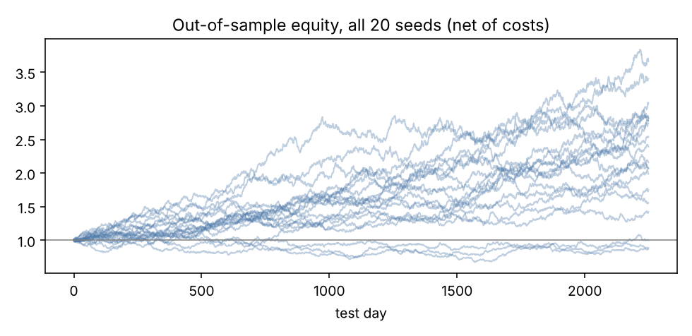

# walkforward-backtester

A small cross-sectional backtester built to be hard to fool yourself with. It has realistic
trading costs, an automatic **look-ahead detector**, and **walk-forward evaluation**, where
parameters are picked on the past and scored only on data they never saw.

It runs on a simulator with a *known* ground truth, so the tests can check that the
engine finds an edge when one exists and finds nothing when none exists. A loader for real
price CSVs is included (`load_prices_csv`). **Every number below comes from simulated
data, not from real markets.**

## What's inside

| Piece | Purpose |
|---|---|
| `engine.backtest` | Weights decided at close *t* earn the return from *t* to *t+1*. Costs and slippage are charged on turnover. |
| `engine.assert_no_lookahead` | Recomputes a signal on truncated history and fails if any past value changes. |
| `walkforward.walk_forward` | Rolling train/test folds. Best parameters on train, scored on the next unseen window. Only out-of-sample days are returned. |
| `metrics` | Sharpe, max drawdown, turnover, block-bootstrap Sharpe confidence interval. |
| `data.simulate_prices` | One-factor market with an optional, slowly-moving per-asset drift. Strength 0 means a pure random walk. |

## Results (reproduce with `python examples/run_experiments.py`)

Setup: 50 assets, 3,000 days, long top 20% / short bottom 20% by trailing momentum,
rebalanced every 5 days, 5 bps cost + 5 bps slippage per unit traded. Lookback grid:
20, 40, 60, 120, 250 days. Walk-forward: train 750 days, test 250 days. Averages over 20
random seeds.

| Market | Best lookback on all data, before costs | Best lookback on all data, after costs | Walk-forward, in-sample | Walk-forward, **out-of-sample** |
|---|---|---|---|---|
| No edge (random walk) | **+0.33** | -0.03 | +0.15 | **-0.26** |
| Planted momentum | 1.31 | 1.01 | 1.17 | **0.81** |

Sharpe ratios, annualised. The first row is the lesson. With no edge at all, trying five
lookbacks and keeping the best produces a Sharpe of +0.33 before costs, which looks like
something. Costs wipe it out, and out-of-sample the strategy loses money. When momentum
really exists, walk-forward still recovers a positive result, lower than the in-sample
number as expected.

**Costs matter.** Planted-momentum market, lookback 120, about 32x annual turnover:

| Cost per unit traded (bps) | Net Sharpe |
|---|---|
| 0 | 1.14 |
| 5 | 0.98 |
| 10 | 0.83 |
| 20 | 0.53 |
| 40 | -0.08 |

The edge disappears at about 40 bps of total cost.

**One seed is not a result.** Out-of-sample net Sharpe across the 20 planted-momentum
seeds ranges from -0.08 to 1.41, median 0.89, and 18 of 20 seeds are positive.



## Use

```python
from backtester import (load_prices_csv, momentum, make_weights, backtest,
                        assert_no_lookahead, walk_forward, summarize)

prices = load_prices_csv("prices.csv")              # wide: one column per ticker
assert_no_lookahead(lambda p: momentum(p, 120), prices)   # fail fast on leaky signals
oos, in_sample, folds = walk_forward(prices, momentum, {"lookback": [60, 120, 250]})
print(summarize(oos))
```

A signal is any function `prices -> scores` that uses only data up to each row's own date.

## Tests

```bash
pip install numpy pandas matplotlib pytest
pytest   # 10 tests
```

They cover the one-day execution delay, cost accounting, dollar-neutral weights, that the
look-ahead detector rejects a leaky signal and accepts a causal one, that a leaky signal
shows a fake Sharpe above 3 on pure noise, and that walk-forward returns only unseen days.

## Limits

- Simulated markets only. They have no fat tails, regime changes, borrow costs, or
  survivorship bias, and real equity momentum is far weaker and less stable than the
  planted kind. Nothing here says a strategy would make money in practice.
- Execution is assumed at the close that generated the signal, with flat bps costs and no
  market impact.
- Five parameter choices is a small search. A larger search overfits more, and a
  deflated-Sharpe adjustment would be a good next addition.
